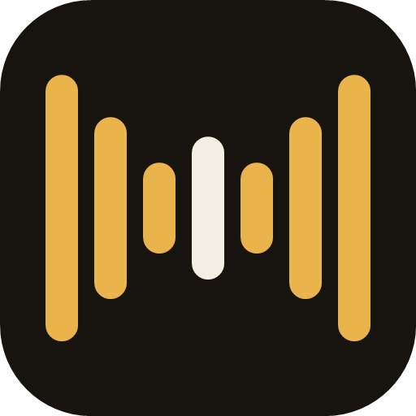
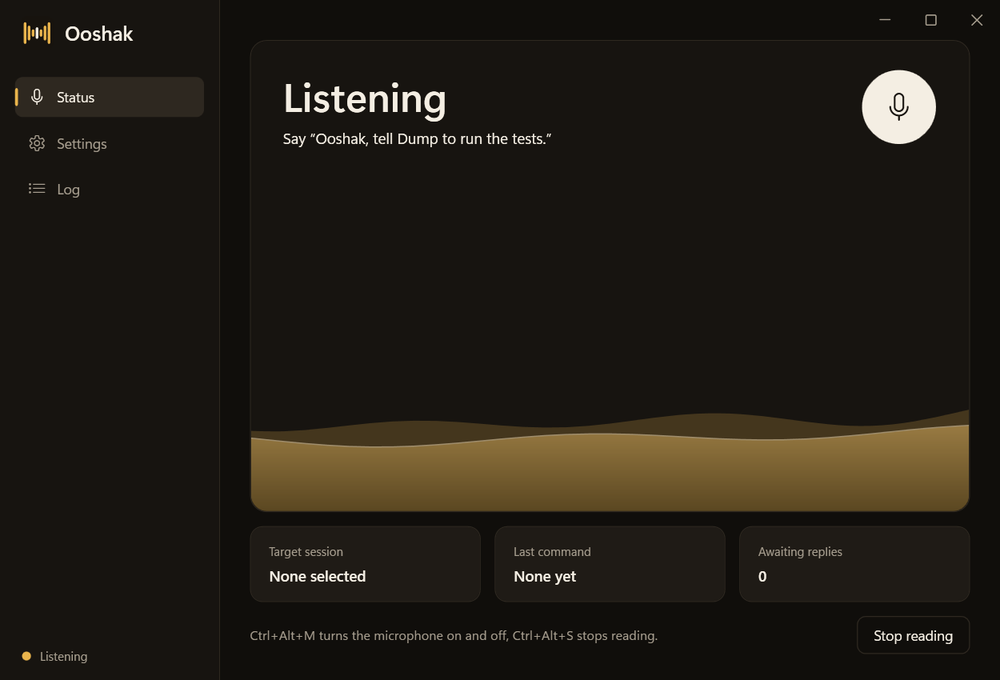

<p align="center">
  
</p>

<h1 align="center">Ooshak</h1>

<p align="center">
  Talk to your Claude Code sessions on Windows, hands free.<br>
  On-device wake word, speech recognition and spoken replies, in Turkish or English.
</p>

<p align="center">
  <a href="https://github.com/Milvasoft/ooshak/releases"></a>
  <a href="https://github.com/Milvasoft/ooshak/actions/workflows/ci.yml"></a>
  <a href="LICENSE"></a>
</p>

<p align="center"><a href="README.tr.md">Türkçe</a></p>

---

You run several Claude Code sessions at once. Ooshak lets you speak to any of them without touching the keyboard: say its name, say which session, say what to do. When the session finishes, Ooshak reads a short, spoken-style answer back to you.

> "Ooshak, tell Atlas to run the tests."
> *(beep, and a minute later)* "All 214 tests passed. Want me to open a pull request?"

Ooshak is a community project. It is not made, endorsed or supported by Anthropic.

<p align="center">
  
</p>

## Features

- **Always listening, nothing leaves your PC.** Silero VAD and Whisper large-v3-turbo run locally on the GPU through Vulkan. Recognizing a sentence takes about 300 ms.
- **Your own wake name.** Say it three times and Ooshak learns how *your* voice sounds to Whisper.
- **Send to any session.** Speak to a session by name or alias, or keep talking to the last one. Messages are typed into the Claude desktop app through UI Automation, without stealing keyboard focus.
- **Spoken replies.** Sessions answer with a short line meant to be heard, read by a local Piper voice. Choose which sessions may speak, from only the ones you addressed to all of them or a single go-between session.
- **Talks like you do.** Turkish with English technical terms ("branch'i merge et") is transcribed correctly, and English words are pronounced correctly by the Turkish voice.
- **Permission popup.** When a session needs approval, a popup shows the exact command with Allow and Deny. It only accepts mouse clicks, so typing elsewhere can never approve anything.
- **Floating island.** A small draggable capsule whose liquid ripples with your voice and turns teal while Ooshak speaks.
- **Polite.** Replies wait until you stop talking, "Ooshak, pause" and "Ooshak, continue" work mid-sentence, and Ooshak goes quiet while a game or video is full screen.
- **Turkish and English** interface, commands and voices.

## Requirements

- Windows 10 or 11, 64-bit
- The [Claude desktop app](https://claude.ai/download) with Claude Code sessions
- A microphone, ideally a headset
- A GPU with Vulkan support is strongly recommended (CPU works but is several times slower)
- About 2 GB of free disk space for the speech models

## Install

1. Download `Ooshak-Setup-<version>-x64.exe` from [Releases](https://github.com/Milvasoft/ooshak/releases) and run it. It installs for the current user only and needs no administrator rights.
   The installer is not code-signed yet, so Windows SmartScreen may warn you. Choose **More info → Run anyway**, or check the file against `SHA256SUMS.txt` first.
2. On first start, choose **Download models**. Ooshak downloads about 1.8 GB once from Hugging Face and GitHub. Every file is pinned to a fixed revision and verified by SHA-256.
3. Choose **Connect to Claude Code**. This adds three hooks to `%USERPROFILE%\.claude\settings.json` (a backup is saved next to it) so Ooshak can hear when a session finishes or needs permission. You can disconnect in Settings at any time; uninstalling removes them too.
4. Optionally open **Settings → Teach with my voice** and say your wake name three times.

## Using it

| Say | What happens |
|---|---|
| "Ooshak, tell Atlas to run the tests" | Sends "run the tests" to the session called Atlas |
| "Ooshak, switch to Atlas" | Makes Atlas the current session |
| "Ooshak, check the logs too" | Sends to the current session |
| "Ooshak, switch to general" | Talks to the general session |
| "Ooshak, pause" / "Ooshak, continue" | Pauses or resumes reading |
| "Ooshak, stop" | Stops reading and drops queued replies |
| "Ooshak, call me boss" | Sessions will address you as "boss" |
| "Ooshak, where are you?" | Tells you the current session |

In Turkish: "Uşak, Atlas'a söyle testleri çalıştırsın", "Uşak, Atlas'a geç", "Uşak dur", "Uşak devam et", "Uşak sus", "Uşak, bana patron de".

Hotkeys: **Ctrl+Alt+M** turns the microphone on and off, **Ctrl+Alt+S** pauses and resumes reading.

Sessions are matched by their title in the Claude app. If several titles start with the same word, add a short alias in **Settings → Session aliases**.

## Privacy

- Audio is processed on your computer and never stored or sent anywhere.
- Ooshak sends text only to the Claude desktop app, by typing it into the session you chose.
- The hooks post session events to `localhost:47811` only. Requests need a custom header, so web pages cannot reach the endpoint.
- Settings, models and the log live in `%USERPROFILE%\.ooshak`. Uninstalling keeps this folder so models are not downloaded again; delete it to remove everything.

## Known limitations

- Ooshak drives the Claude desktop app through its accessibility tree. An app update that changes the layout can break message delivery until Ooshak is updated.
- With loudspeakers, some of Ooshak's own voice can reach the microphone. Echo filtering handles most of it; a headset avoids it entirely.
- The Turkish voice model is licensed for non-commercial use only (CC BY-NC-SA 4.0). It is downloaded by each user and not distributed with Ooshak.

## Build from source

```powershell
git clone https://github.com/Milvasoft/ooshak.git
cd ooshak
dotnet test
dotnet run --project src/Ooshak
```

You need the .NET 10 SDK. The first run asks to download the models, or run `dotnet run --project src/Ooshak.Cli -- download-models`.
To build the installer, install [Inno Setup 6](https://jrsoftware.org/isinfo.php), publish to `artifacts/publish` and run `ISCC.exe installer\Ooshak.iss`. The [release workflow](.github/workflows/release.yml) shows the exact steps.

| Project | Purpose |
|---|---|
| `src/Ooshak.Core` | Audio, speech, routing, Claude app automation, hooks |
| `src/Ooshak` | WPF tray app, windows and the floating island |
| `src/Ooshak.Cli` | Developer tool for testing pieces without the UI |
| `tests/Ooshak.Tests` | xUnit tests |

## Contributing

Ideas, bug reports and pull requests are welcome. Please read [CONTRIBUTING.md](CONTRIBUTING.md) and our [Code of Conduct](CODE_OF_CONDUCT.md). Report security issues privately as described in [SECURITY.md](SECURITY.md).

## License

Ooshak is released under the [MIT License](LICENSE). The models and voices it downloads have their own licenses, listed in [THIRD-PARTY-NOTICES.md](THIRD-PARTY-NOTICES.md).
