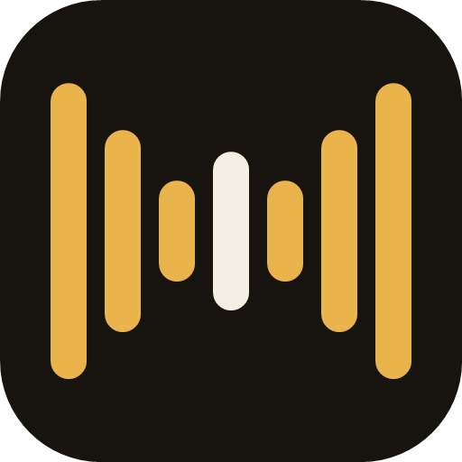

  

<h1 align="center">Ooshak</h1>

  Windows'ta Claude Code oturumlarınla elini klavyeye sürmeden konuş. 
  Cihazda çalışan çağrı adı, konuşma tanıma ve sesli cevap; Türkçe veya İngilizce.

<a href="README.md">English</a>

---

Aynı anda birçok Claude Code oturumu çalıştırıyorsun. Ooshak ile herhangi birine klavyeye dokunmadan seslenirsin: adını söyle, hangi oturum olduğunu söyle, ne yapılacağını söyle. Oturum işini bitirince Ooshak sana kısa, konuşma diliyle bir cevap okur.

> "Uşak, Atlas'a söyle testleri çalıştırsın."
> *(bip, bir dakika sonra)* "214 testin hepsi geçti. Pull request açayım mı?"

Ooshak bir topluluk projesidir. Anthropic tarafından yapılmamış, onaylanmamış veya desteklenmemektedir.

## Özellikler

- **Sürekli dinler, hiçbir şey bilgisayarından çıkmaz.** Silero VAD ve Whisper large-v3-turbo GPU'da Vulkan ile yerel çalışır. Bir cümle yaklaşık 300 ms'de yazıya döner.
- **Kendi çağrı adın.** Üç kez söylersin, Ooshak senin sesinin Whisper'a nasıl geldiğini öğrenir.
- **Her oturuma gönderim.** Adıyla veya takma adıyla seslenirsin, ya da son oturumla konuşmaya devam edersin. Mesaj Claude masaüstü uygulamasına klavye odağını çalmadan yazılır.
- **Sesli cevaplar.** Oturumlar dinlenmek için yazılmış kısa bir satırla cevap verir, yerel Piper sesi okur. Hangi oturumların konuşacağını seçersin; yalnızca seslendiklerin, hepsi ya da tek bir aracı oturum.
- **Senin gibi konuşur.** İngilizce teknik terimli Türkçe ("branch'i merge et") doğru yazılır, Türkçe ses İngilizce kelimeleri doğru okur.
- **İzin popup'ı.** Bir oturum onay istediğinde tam komut **İzin ver** ve **Reddet** düğmeleriyle görünür. Yalnızca fare tıklamasını kabul eder, başka yerde yazarken yanlışlıkla onay verilemez.
- **Yüzen ada.** Sesinle dalgalanan, Ooshak konuşurken turkuaza dönen, sürüklenebilir küçük bir kapsül.
- **Kibar.** Cevaplar sen susunca okunur, "Uşak dur" ve "Uşak devam et" okuma sırasında da çalışır, tam ekran oyun ve videoda Ooshak susar.

## Gereksinimler

- Windows 10 veya 11, 64 bit
- [Claude masaüstü uygulaması](https://claude.ai/download) ve Claude Code oturumları
- Mikrofon, tercihen kulaklık
- Vulkan destekli GPU şiddetle önerilir (CPU'da çalışır ama birkaç kat yavaştır)
- Konuşma modelleri için yaklaşık 2 GB boş alan

## Kurulum

1. [Releases](https://github.com/Milvasoft/ooshak/releases) sayfasından `Ooshak-Setup-<sürüm>-x64.exe` dosyasını indirip çalıştır. Yalnızca senin kullanıcın için kurulur, yönetici yetkisi istemez.
   Kurulum dosyası henüz imzalı değil, Windows SmartScreen uyarabilir. **Ek bilgi → Yine de çalıştır** de, istersen önce `SHA256SUMS.txt` ile karşılaştır.
2. İlk açılışta **Modelleri indir**'e bas. Ooshak yaklaşık 1,8 GB'ı bir kez Hugging Face ve GitHub'dan indirir. Her dosya sabit bir sürüme bağlıdır ve SHA-256 ile doğrulanır.
3. **Claude Code'a bağla**'ya bas. Bu, `%USERPROFILE%\.claude\settings.json` dosyasına üç hook ekler (yanına yedek alınır). Ayarlar'dan istediğin zaman kaldırabilirsin, kaldırma işlemi de bunları siler.
4. İstersen **Ayarlar → Sesimle öğret** ile çağrı adını üç kez söyle.

## Kullanım

| Söyle | Ne olur |
|---|---|
| "Uşak, Atlas'a söyle testleri çalıştırsın" | Atlas oturumuna "testleri çalıştırsın" gider |
| "Uşak, Atlas'a geç" | Atlas o anki oturum olur |
| "Uşak, loglara da bak" | O anki oturuma gider |
| "Uşak, genele geç" | Genel oturumla konuşursun |
| "Uşak dur" / "Uşak devam et" | Okumayı duraklatır veya sürdürür |
| "Uşak sus" | Okumayı keser, sıradakileri siler |
| "Uşak, bana patron de" | Oturumlar sana "patron" diye hitap eder |
| "Uşak, neredesin?" | O anki oturumu söyler |

Kısayollar: **Ctrl+Alt+M** mikrofonu açar ve kapatır, **Ctrl+Alt+S** okumayı duraklatır ve sürdürür.

## Gizlilik

- Ses bilgisayarında işlenir, hiçbir yere kaydedilmez veya gönderilmez.
- Ooshak metni yalnızca Claude masaüstü uygulamasına, seçtiğin oturuma yazarak gönderir.
- Hook'lar oturum olaylarını yalnızca `localhost:47811` adresine yollar.
- Ayarlar, modeller ve günlük `%USERPROFILE%\.ooshak` klasöründedir. Kaldırma bu klasörü bırakır; her şeyi silmek için klasörü sil.

## Bilinen sınırlar

- Ooshak, Claude uygulamasını erişilebilirlik ağacı üzerinden kullanır. Arayüzü değiştiren bir güncelleme, Ooshak güncellenene kadar gönderimi bozabilir.
- Hoparlörle kullanınca sesin bir kısmı mikrofona dönebilir. Yankı filtresi çoğunu yakalar, kulaklıkla sorun tamamen kalkar.
- Türkçe ses modeli yalnızca ticari olmayan kullanım için lisanslıdır (CC BY-NC-SA 4.0). Ooshak ile dağıtılmaz, her kullanıcı kendisi indirir.

## Katkı

Fikirler, hata bildirimleri ve pull request'ler memnuniyetle karşılanır. Lütfen [CONTRIBUTING.md](CONTRIBUTING.md) ve [Davranış Kuralları](CODE_OF_CONDUCT.md) dosyalarını oku. Güvenlik açıklarını [SECURITY.md](SECURITY.md) dosyasındaki gibi gizli bildir.

## Lisans

Ooshak [MIT Lisansı](LICENSE) ile yayınlanır. İndirdiği modellerin ve seslerin kendi lisansları [THIRD-PARTY-NOTICES.md](THIRD-PARTY-NOTICES.md) dosyasındadır.
